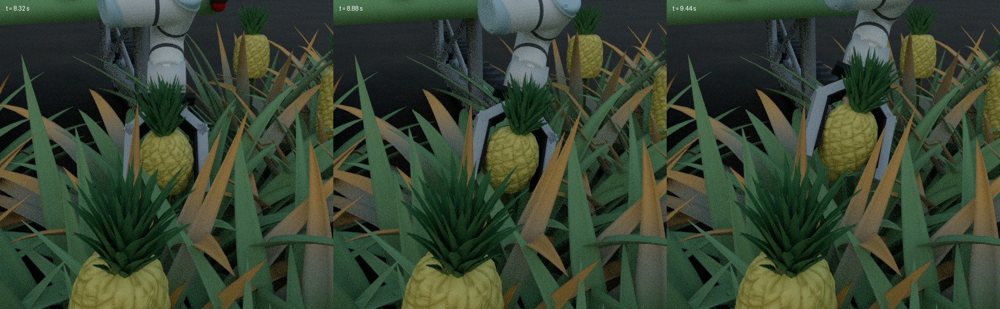
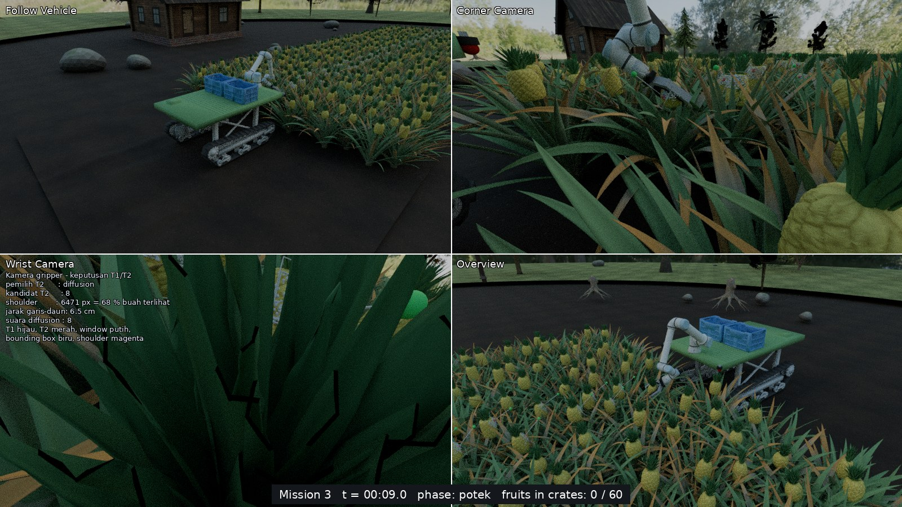

# Evaluasi Mission 3 di NVIDIA Isaac Sim (USD beranimasi + video 4 kamera)

Isaac Sim dipakai dengan peran yang sama seperti Drake Meshcat di project ini: **penampil hasil evaluasi**.
MuJoCo tetap menjalankan fisika, policy, kamera dan pengukuran; Isaac Sim memutar ulang rekamannya.
Tidak ada training ulang dan tidak ada fisika yang berjalan di Isaac Sim.

```
scripts/eval_xgh.py          MuJoCo: evaluasi Mission 3  ->  recording.npz + result.json
scripts/export_usd.py        recording.npz  ->  usd/mission3.usdc + textures/ + mission3_meta.json   (tanpa GPU)
scripts/isaac_view.py        Isaac Sim (jendela): buka USD, Play, kamera bebas
scripts/isaac_render_video.py Isaac Sim (headless): video MP4, 4 kamera dalam satu frame
```

## 1. Menjalankan

```bash
# (a) evaluasi di MuJoCo - sama seperti sebelumnya; --detach potek = gerakan panen baru (bagian 4)
python scripts/eval_xgh.py --onnx models/mission3_v1.onnx --detach potek --tag potek_baris_penuh --every 2 --no-html

# (b) rekaman -> USD (pip install usd-core; tidak perlu Isaac Sim)
python scripts/export_usd.py --tag potek_baris_penuh
#   -> outputs/eval_xgh/potek_baris_penuh/usd/mission3.usdc, textures/, mission3_meta.json
#   --parts 2        : dipecah jadi mission3_part01.usdc, mission3_part02.usdc
#   --sky mesh       : kubah panorama sebagai mesh (persis Meshcat) alih-alih dome light
#   --no-scenery     : tanpa tanah luar / batu / pohon / pondok

# (c) opsi 1 - lihat di Isaac Sim, kamera bebas
#     File > Open > mission3.usdc, lalu tekan Play.   Atau:
./python.sh <repo>/scripts/isaac_view.py --usd <repo>/outputs/eval_xgh/potek_baris_penuh/usd/mission3.usdc

# (d) opsi 2 - video 4 kamera (Isaac Sim headless, butuh GPU RTX)
./python.sh <repo>/scripts/isaac_render_video.py --usd <...>/usd/mission3.usdc
./python.sh <repo>/scripts/isaac_render_video.py --usd <...>/usd/mission3.usdc --start 60 --duration 30
./python.sh <repo>/scripts/isaac_render_video.py --usd <...>/usd/mission3.usdc --speed 4        # time lapse 4x
```

`./python.sh` adalah Python milik Isaac Sim (Windows: `python.bat`). Kalau Isaac Sim dipasang lewat pip, cukup `python`.
Folder `usd/` harus dipindahkan utuh (file `.usdc` memakai `./textures/...` secara relatif).

## 2. Isi file USD

| Path | Isi |
|---|---|
| `/World/scene/<body>` | satu Xform per body MuJoCo; pose dunia sebagai time sample (translate + orient) |
| `/World/scene/<body>/g<id>` | geom visual: mesh (instance dari `/_Prototypes`) atau primitif; visibilitas beranimasi (isi keranjang, buah terpetik, lampu indikator, pertukaran LOD mesh tetap <-> bergerak) |
| `/World/scene/vehicle/cam_follow`, `cam_corner`, `/World/scene/gripper_housing/cam_wrist` | kamera yang sama dengan panel kamera HTML |
| `/World/cameras/overview` | kamera ke-4: dari depan-kiri lengan, ikut maju bersama kendaraan |
| `/World/overlay`, `/World/overlay_wrist` | keputusan T1 (hijau) / T2 (merah), garis, window, bounding box, shoulder, kandidat - tampil selama target itu aktif |
| `/World/scenery` | dekorasi yang sama dengan Meshcat (`pinesim/viz/scenery.py`, seed sama): tanah, rumput, 34 batu, 22 pohon, 8 tunggul, pondok |
| `/World/lights` | `sky` (dome light dengan foto panorama yang sama) + `sun` |

- Z ke atas, satuan meter, `timeCodesPerSecond` = laju rekaman (`--every 2` -> 25 fps).
- Mesh tetap -> bergerak -> tetap (LOD) tidak perlu logika di Isaac Sim: slot interaktif dan mesh statis sama-sama
  mengikuti pose rekaman; yang tidak dipakai disembunyikan (`visibility`).
- Sebelum setiap lompatan pose ditulis satu "hold key", supaya interpolasi linear USD tidak membuat benda melayang pelan
  (aturan yang sama dengan ekspor Meshcat).
- Warna: vertex colour glTF -> `primvars:displayColor`; mesh bertekstur -> `UsdPreviewSurface` + tekstur di `textures/`.

Di Isaac Sim: kamera bebas = viewport *Perspective* (Alt + mouse); kamera lain dipilih di menu kamera viewport.
Overlay keputusan bisa dimatikan dengan ikon mata pada `/World/overlay_wrist` atau `/World/overlay`.
Video dari jendela Isaac Sim juga bisa dibuat dengan *Window > Rendering > Movie Capture*.

## 3. Video 4 kamera

Satu frame berisi 2 x 2 kamera (default 960 x 540 per kamera -> 1920 x 1080):

```
Follow Vehicle | Corner Camera
Wrist Camera   | Overview          + baris bawah: waktu, fase, jumlah buah di keranjang; teks keputusan T1/T2 di kotak wrist
```

`--cameras follow wrist` memilih kamera (satu kamera = satu frame penuh), `--tile W H` ukuran per kamera,
`--subframes N` kualitas RTX, `--renderer PathTracing` untuk path tracing, `--dry-run` menguji penyusunan frame dan
penulisan MP4 tanpa Isaac Sim (kotak warna sebagai pengganti gambar kamera).

## 4. Gerakan panen "potek" (`--detach potek`)

Bagian panen yang scripted diganti: gripper tidak lagi **memuntir** nanas pada sumbunya lalu mencabut, tetapi
**mematahkannya ke samping sambil mengangkat**, seperti memetik pucuk teh.

1. Jepit dan re-grip seperti biasa.
2. Tangan memiringkan buah terhadap pangkal buah (sambungan tangkai) ke arah samping = arah menutup rahang, sampai
   `potek_max_deg` (40 deg, 50 deg/s), sambil naik sepanjang sumbu buah (`potek_lift` 3 cm pada sudut penuh).
   Arah kiri / kanan dipilih dari uji kelayakan (IK, tabrakan, buah tetangga, tangkai sendiri, daun yang tersapu).
3. Tangkai patah -> buah diangkat 6 cm selagi masih miring, baru ditegakkan lagi, lalu fase retreat / lift / transport
   yang lama. Satu arah gagal -> arah sebaliknya; dua-duanya gagal -> re-grip dan tarik sepanjang sumbu (cara lama).

Yang berubah di model:

| Hal | Sebelum | `--detach potek` | Catatan |
|---|---|---|---|
| Patahnya tangkai | tarik (60-120 N) atau puntir (0,8-2,0 N m); dorongan samping hanya membengkokkan | + lentur: `F / F_patah + M / M_patah >= 1`, `M_patah` 8-14 N m | **asumsi [PROV]**, belum diukur pada tangkai nyata. Kekakuan lentur 40 N m/rad -> 11-20 deg lentur murni. Urutan kekuatan tiap tanaman sama dengan kekuatan puntirnya, jadi tata letak lahan (seed) tidak berubah |
| Gesekan pad gripper | 1,2 | 1,8 | supaya buah tidak mudah lepas saat diangkat |
| Policy, perception, planner, fase lain | - | tidak berubah | policy residual hanya aktif di fase approach dan line |

Nilainya ada di `configs/mission1.yaml` (`harvest.detach_mode`, `harvest.potek`, `harvest.potek_*`). Tanpa
`--detach potek` semuanya persis seperti sebelumnya (default `twist`).

Karena tangkai sekarang bisa patah oleh lentur, dorongan samping yang tidak disengaja (lengan menyenggol buah) juga
bisa mematahkannya - simulasi jadi sedikit lebih ketat, bukan lebih longgar.



*Tiga saat dari USD hasil run di bawah (t = 8,3 s, 8,9 s, 9,4 s). Gambar pratinjau ini dan pratinjau 4 kamera di bawah
dirender dari file USD dengan Blender (Cycles), bukan dengan Isaac Sim; pencahayaan dan material di Isaac Sim akan berbeda.*



## 5. Hasil evaluasi (MuJoCo, baris penuh 60 tanaman)

Satu kali jalan, seed 990000, lahan seed 2026 (lahan dan policy yang sama dengan `outputs/eval_xgh/baris_penuh_onnx`),
policy `models/mission3_v1.onnx`, tanpa training ulang. Sumber: `outputs/eval_xgh/potek_baris_penuh/result.json`.

| | twist (hasil lama) | potek (`--detach potek`) |
|---|---|---|
| Buah di keranjang | 56 / 60 | **60 / 60** |
| Dijepit / tangkai patah | 59 / 58 | 60 / 60 |
| Buah dilewati | 2 jatuh, 2 jepitan meleset | 0 |
| Cara tangkai patah | puntir (+ tarik) | 57 potek, 3 tarik (potek tidak layak: jangkauan / buah tetangga) |
| Sudut miring saat patah | - | rata-rata 22,7 deg (17 - 33 deg) |
| Observasi -> keranjang, rata-rata | 27,0 s | 21,9 s |
| Buah selesai < 40 s | 54 dari 56 | 60 dari 60 |
| Kerusakan daun (leaf_damage) | 26 | 16 |
| Daun tercabut (damage_events) | 0 | 0 |
| Waktu simulasi | 1484 s | 1309 s |
| Median galat estimasi pusat buah | 0,61 cm | 0,62 cm |

Cara membacanya:
- Ini **satu baris, satu seed**. 60/60 (selang kepercayaan 95 %: 94 - 100 %) dan 56/60 (84 - 97 %) masih tumpang tindih,
  jadi "potek lebih baik" belum terbukti secara statistik; yang terbukti: gerakannya berjalan di seluruh baris.
- Tiga hal berubah sekaligus (gerakan, gesekan pad 1,8, tangkai bisa patah oleh lentur). Hasilnya tidak bisa dipisahkan
  per faktor tanpa menjalankan ablation (mis. potek dengan gesekan 1,2).
- Kekuatan lentur tangkai 8 - 14 N m adalah asumsi. Tangkai yang lebih kuat akan butuh sudut lebih besar atau jatuh ke
  cadangan "tarik"; nilainya perlu diukur pada tangkai nyata sebelum angka ini dipakai untuk klaim sim-to-real.
- Mode default (`twist`) diuji ulang setelah perubahan kode: hasil dan log event identik dengan sebelum perubahan.

Keluaran yang dihasilkan dari run ini: `usd/mission3.usdc` (50 MB, 32 719 frame = 21 menit 49 detik pada 25 fps,
2 400 body, 3 516 objek, 549 mesh unik, 60 overlay keputusan) + `textures/` (20 file) + `mission3_meta.json`.

## 6. Yang sudah dan belum diuji

Sudah diuji (tanpa Isaac Sim, `pytest -q tests/test_isaac_export.py` + pemeriksaan di bawah):
- USD dibuka kembali dengan pustaka OpenUSD; kotak pembatas mesh di USD dibandingkan dengan mesh hasil kompilasi MuJoCo
  pada frame acak (selisih terbesar sekitar 1 mm) dan status tampil / sembunyi cocok dengan rekaman.
- USD dirender dengan pembaca USD lain (Blender) dari keempat kamera untuk memastikan mesh, warna, tekstur dan kamera benar.
- Penyusunan frame 4 kamera, HUD dan penulisan MP4 (`--dry-run`).

Belum diuji: **menjalankan di Isaac Sim itu sendiri** (lingkungan pembuatnya tidak punya GPU RTX). Skrip memakai API
Isaac Sim 6.x yang terdokumentasi (`SimulationApp`, `omni.replicator` render product + annotator `rgb`,
`omni.timeline`). Hal yang mungkin perlu disetel saat pertama kali dijalankan:
- kecerahan: `inputs:intensity` pada `/World/lights/sky` (1000) dan `/World/lights/sun` (2500);
- arah foto panorama: `xformOp:rotateZ` pada `/World/lights/sky`; kalau langit tampak salah, pakai `--sky mesh`;
- kalau gambar video tertinggal satu frame dari HUD, itu berasal dari cara Replicator memajukan timeline.
